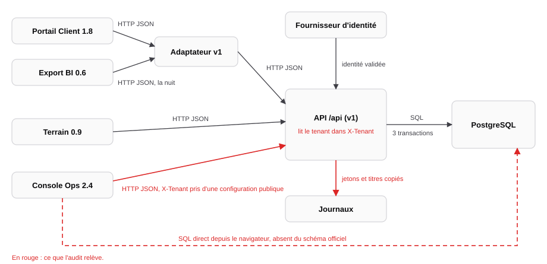
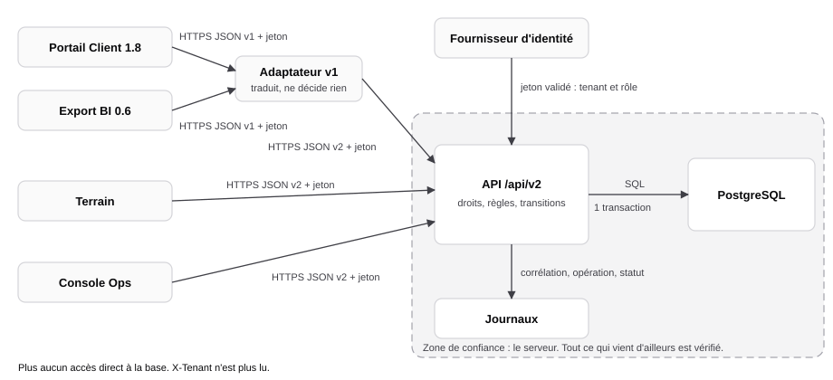
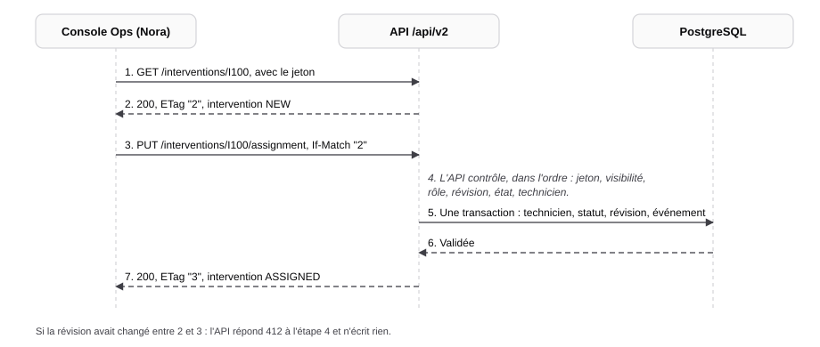

# Architecture et responsabilités

Ce document montre ATLAS tel qu'il marche aujourd'hui, puis tel que je le propose. Les constats
cités sont ceux de l'annexe A du rapport, les décisions celles de `Decisions_Techniques.md`.

## 1. L'existant reconstitué

Le schéma officiel d'ATLAS ne montre pas tout (P05 l.6–15). J'y ai ajouté ce que les pièces
prouvent : l'accès direct à la base, l'en-tête `X-Tenant` et les journaux.

| Flux | Acteur | Protocole | Frontière de confiance | Preuve |
|---|---|---|---|---|
| Portail 1.8 vers l'adaptateur, puis l'API | Demandeur | HTTP JSON, format v1 | Aucune : l'API croit ce qu'on lui envoie | P05 l.8, l.12 ; P09 l.7–8 |
| Export BI vers l'adaptateur, puis l'API | Compte de reporting, la nuit | HTTP JSON, format v1 | Aucune | P05 l.11 ; P09 l.8 |
| Console Ops vers l'API | Planificateur | HTTP JSON, avec `X-Tenant` pris d'une configuration publique | Aucune | P05 l.9 ; `config-demo.json` l.4 |
| Console Ops vers PostgreSQL | Planificateur, depuis son navigateur | SQL direct | Contournée : l'API n'est pas sur le chemin | `code/front.mjs` l.7–9 ; P05 l.31–35 |
| Terrain vers l'API | Technicien | HTTP JSON | Aucune : Terrain calcule lui-même les transitions | P05 l.10 ; P06 l.54 |
| Fournisseur d'identité vers l'API | Aucun utilisateur | Identité validée | La seule source fiable, mais l'API lit le tenant ailleurs | P05 l.14, l.29 ; P09 l.19–21 |
| API vers PostgreSQL | API | SQL, trois transactions pour une affectation | Sans objet | P05 l.13, l.50–53 |
| API vers les journaux | API | Écriture de journaux | Jetons et titres copiés | `code/back.mjs` l.7 ; P09 l.26–27 |

## 2. La cible

| Flux | Acteur | Protocole | Frontière de confiance |
|---|---|---|---|
| Console Ops et Terrain vers l'API v2 | Planificateur, technicien | HTTPS JSON, avec le jeton | L'entrée de l'API : tout est vérifié à chaque requête |
| Portail 1.8 et export BI vers l'adaptateur, puis l'API v2 | Demandeur, compte de reporting | HTTPS JSON, format v1 puis v2, avec le jeton | L'adaptateur traduit, passe le jeton tel quel et ne décide d'aucun droit. C'est l'API qui vérifie |
| Fournisseur d'identité vers l'API | Aucun utilisateur | Jeton validé | Le tenant et le rôle viennent de là, et de nulle part ailleurs |
| API vers PostgreSQL | API | SQL, une transaction par écriture | Seule l'API accède à la base |
| API vers les journaux | API | Identifiant de corrélation, opération, statut | Ni jeton ni texte libre |

Ce qui disparaît : l'accès direct à la base, la lecture de `X-Tenant`, les transitions calculées par
Terrain, la validation faite seulement dans le navigateur.

## 3. Un échange HTTP : une affectation

Nora lit I100, puis l'affecte au technicien T01. L'API vérifie tout, puis écrit en une seule
transaction. Les fichiers de cet échange sont `affectation-requete-valide.json` et
`affectation-reponse-200.json`. Le cas du conflit est le scénario SC-11.

## 4. Qui fait quoi

| Sujet | Front | Back (l'API) | Stockage | Identité |
|---|---|---|---|---|
| Affichage | Affiche les données et les états d'écran. Met les instants à l'heure locale | Renvoie des données complètes et des erreurs lisibles | Rien | Rien |
| Validation | Contrôle la saisie, pour le confort | Applique toutes les règles, pour tous les clients | Types et contraintes des colonnes | Rien |
| Droits | Cache ce qui n'est pas permis. Ce n'est pas une protection | Vérifie le rôle et le périmètre à chaque requête | Garantit que site, technicien et intervention sont du même tenant | Fournit le tenant et le rôle dans le jeton |
| Transitions | Propose les actions possibles | Décide seul des transitions du cycle | Garde le statut | Rien |
| Concurrence | Garde l'`ETag` lu, envoie `If-Match`, propose de relire après un 412 | Compare la révision et refuse si elle a changé | Écrit l'état et la révision dans une transaction | Rien |
| Historique | L'affiche | Écrit un événement par changement réel, dans la même transaction | Garde les événements, en ajout seulement | Fournit l'acteur |

## 5. Les données

Seule l'API lit et écrit la base. Le modèle stocké n'est pas le modèle publié (P05 l.57–60) :

| Colonne stockée | Champ publié | Transformation |
|---|---|---|
| `id` | `id` | Aucune |
| `tenant_id` | Non publié | Sert au contrôle du périmètre |
| `site_id` | `siteId` | Le nom |
| `title` | `title` | Espaces du bord retirés à l'écriture |
| `priority` | `priority` | Les anciennes valeurs sont converties (hypothèse H1 de l'annexe A) |
| `status` | `status` | Aucune |
| `technician_id` | `technicianId` | Le nom. `null` s'il n'y a personne |
| `created_at`, `updated_at` | `createdAt`, `updatedAt` | Texte en UTC, avec les secondes |
| `revision` | `revision` et en-tête `ETag` | Entre guillemets dans l'`ETag` |
| Événement : `actor_id`, `kind`, `at`, `revision` | `actorId`, `type`, `at`, `revision` | Les noms |

À ajouter dans la base : des contraintes qui lient le site et le technicien au tenant de
l'intervention (P05 l.27–29), et un index pour la liste, sur le tenant, le statut, le site, la date
et l'identifiant. Aujourd'hui les index ne portent que sur `id` et `created_at` (P05 l.60).

**Temps de réponse.** L'objectif est de moins de 500 ms au 95e centile pour une page de 20
(P03 l.46–49). Il n'est pas mesuré ici : aucune infrastructure n'est fournie. Méthode proposée :
charger une base avec les volumes annoncés, soit environ 83 000 demandes pour un an (P02 l.5–6),
lancer 1 000 lectures de la liste avec et sans filtres, et relever le 95e centile. Ce qui coûte :
le comptage du `total`, un index manquant, une page lointaine.

## 6. Continuité v1 et migration

On corrige d'abord la sécurité, pour tout le monde. Puis on migre un consommateur à la fois.
Personne n'est arrêté.

| Étape | Ce qui change | On continue si | On revient en arrière si |
|---|---|---|---|
| 0. Sécurité, tout de suite, v1 comprise | Le tenant vient du jeton. Plus de lecture entre tenants. Plus de jeton ni de titre dans les journaux | Les scénarios SC-08 et SC-12 passent en recette | Jamais. Une correction de sécurité ne revient pas (P09 l.37–38) |
| 1. Console Ops passe en v2 | Liste, détail, modification et affectation par la v2. Son accès direct à la base est supprimé | Pendant la période d'observation, pas de hausse des erreurs ni des temps de réponse (P09 l.36–37) | Les erreurs montent : la console reprend ses routes v1, sans l'accès direct |
| 2. Terrain passe en v2 | Commencer et terminer par la route de transition | Même critère | Les erreurs montent : Terrain reprend la v1 |
| 3. Fermeture des écritures v1 | `PUT /api/intervention/{id}` et `GET /api/assign` sont fermées | Plus aucun appel sur ces routes pendant l'observation | Un consommateur oublié apparaît : réouverture courte, annoncée |
| 4. Portail 1.8 et export BI | Ils restent en v1, par l'adaptateur, jusqu'à la fin de la transition | Le scénario SC-12 passe à chaque livraison | Sans objet |

La fin de la transition est proposée au 31 janvier 2027. C'est à ATLAS de la confirmer
(P03 l.27–31).

Ce que ça coûte : un ancien usage non autorisé peut cesser de marcher dès l'étape 0, et il faut le
dire à la direction (P09 l.38–39). Jusqu'à l'étape 1, l'accès direct à la base existe encore :
c'est pour ça que la console migre en premier.

Ce dont ça dépend : le fournisseur d'identité, qui doit mettre le tenant et le rôle dans le jeton
(P09 l.18–20), et l'adaptateur, qui doit rester en service pendant toute la transition.
