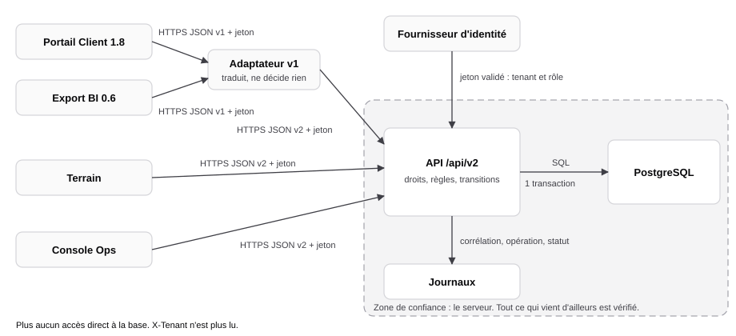
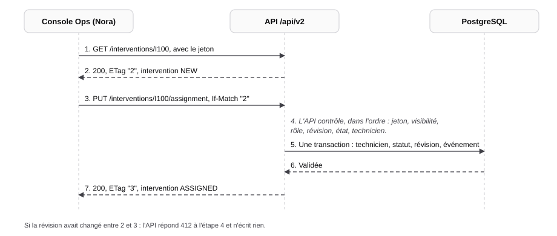

<div class="diapos" markdown="1">

# ATLAS, audit et contrat d'intégration. Tristan Gerber, Mastère 2 Informatique, novembre 2026.

## 1. Le problème prioritaire : le serveur croit ce qu'on lui envoie

Lina est du client C01. Elle demande une intervention du client C02, et elle la reçoit :

```
GET /api/intervention/I200 HTTP/1.1
Authorization: Bearer DEMO-U01-C01
X-Tenant: C02

HTTP/1.1 200 OK
{"id":"I200","tenantId":"C02","siteId":"S20","title":"Accès local réseau","status":"NEW"}
```

Extrait d'une capture du kit, `http/isolement.http`.
{: .source }

- J'ai trouvé 14 problèmes, sous 5 causes. Les 4 problèmes critiques viennent de celle-ci.
- Deux de ces critiques n'avaient aucun ticket.
- Je la traite d'abord : tant que le serveur ne sait pas qui appelle, aucune autre correction ne tient.

## 2. L'architecture : tout passe par l'API



- Le tenant et le rôle viennent du jeton validé, de rien d'autre.
- Seule l'API accède à la base. Une écriture, une transaction.
- Le Portail 1.8 et l'export BI gardent la v1, derrière un adaptateur qui traduit sans rien décider.

## 3. Un échange complet : Nora affecte I100 au technicien T01



- La requête ne contient que le technicien. Le tenant et le rôle viennent du jeton.
- `If-Match` porte la révision lue. Si elle a changé : 412, rien n'est écrit, l'écran propose de relire.
- Le technicien, le statut, la révision et l'événement d'historique sont écrits ensemble, ou pas du tout.

## 4. Un arbitrage : que faire de la v1 ?

Douze tenants utilisent encore le Portail 1.8, et l'export BI lit la v1 chaque nuit. ATLAS ne peut
pas les interrompre. Mais la v1 a des brèches.

| Option | Décision |
|---|---|
| A. Un nouveau contrat sous `/api/v2`, la v1 gardée derrière l'adaptateur | Retenue |
| B. Les mêmes routes, avec la version dans un en-tête | Écartée : les clients v1 n'envoient pas cet en-tête |
| C. Tout remplacer d'un coup | Écartée : il faudrait arrêter le portail |

- **Bénéfice** : personne n'est coupé, et la sécurité est corrigée tout de suite, v1 comprise.
- **Coût** : deux contrats à tester pendant la transition.
- **Touchés** : tous. Un ancien usage non autorisé peut cesser de marcher.
- **Risque qui reste** : on ne sait pas exactement ce que l'adaptateur renvoie aujourd'hui.

## 5. Une preuve : un script contrôle le contrat et les 25 exemples

```
python Tests_et_Validations/outils/controle_contrat.py .

   ok    81 références, 0 cassée(s)
   ok    structure valide : 0 erreur(s)
   ok    25 fichiers dans Exemples_JSON/, 25 prévus par ce script
   ok    creation-requete-titre-court.json est refusé par InterventionCreation, par une seule règle : [('title', 'minLength')]
Bilan : tout passe. Limite : contrôle statique, sans serveur.
```

Extrait de `Tests_et_Validations/sorties/controle_contrat.txt`.
{: .source }

- **Ce que ça prouve** : le contrat est un OpenAPI 3.1 valide, et chaque exemple suit son schéma.
- **Ce que ça ne prouve pas** : les droits, les transitions, le temps de réponse. Il n'y a pas de serveur.
- **Une erreur corrigée** : le validateur laissait passer une date fausse. Il manquait un paquet.

</div>
