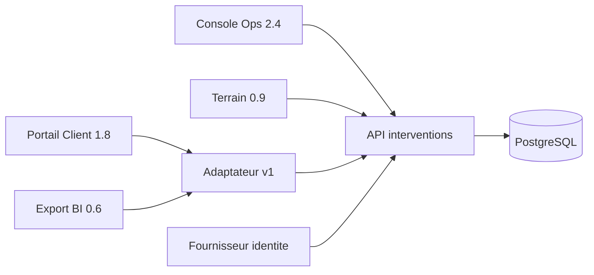
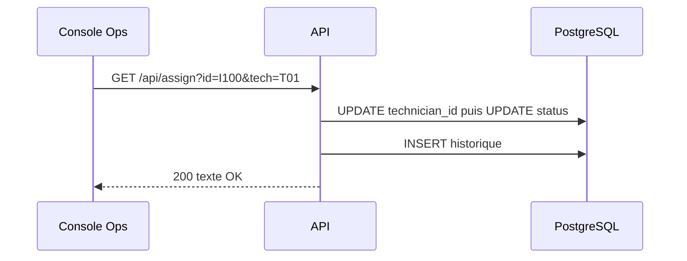

# P05 — Architecture telle que décrite par l'équipe plateforme

Note de Hugo, responsable plateforme, 10 septembre 2026, actualisation manuscrite
du 20 octobre. La fiche couvre les composants, pas un engagement de comportement.

Le Portail reçoit des champs historiques français et transforme le statut pour
l'affichage. Console Ops appelle directement les routes de la passerelle /api.
Terrain utilise le même service avec une présentation plus compacte. Le service
interventions est déployé comme un monolithe ; la séparation en microservices
n'est pas une contrainte de l'exercice.

## Répartition annoncée

La note de septembre attribue la validation de longueur du titre au Portail et
le calcul des transitions autorisées à Terrain. L'API « enregistre ce que l'écran
a validé ». La base possède une clé primaire sur chaque table, mais la note ne
mentionne pas de contrainte garantissant l'appartenance commune du site et de
l'intervention au même tenant. L'API lit le tenant envoyé dans X-Tenant.

L'équipe considère PostgreSQL comme la source des états. La console a toutefois
introduit en octobre un accès direct à une vue SQL pour charger plus vite les
listes, illustré par la configuration jointe. La cartographie officielle n'a pas
été révisée après cette expérimentation. La vue est réputée « interne », alors
que ses paramètres sont insérés dans la configuration du client Web.

## Séquence publiée pour l'affectation

Ces trois écritures sont actuellement exécutées dans des transactions séparées.
Un échec de la seconde étape peut donc laisser l'affectation renseignée sans
changement de statut ; un échec de la troisième supprime la preuve de mutation.
Les développeurs ne disposent pas d'un test commun des effets attendus.

## Éléments de stockage disponibles

Interventions : id texte, tenant_id texte, site_id texte, title texte, priority
texte, status texte, technician_id nullable, created_at timestamp UTC, updated_at
timestamp UTC, revision entier. Events : id, intervention_id, actor_id, kind,
at, revision. Les index actuels portent sur id et created_at. Les contraintes
de référence et les frontières d'accès sont à expliciter dans la proposition.

## Note d'intégration du 20 octobre

L'adaptateur v1 convertit des noms de champs, mais n'est pas censé décider des
droits. Aucun appel navigateur ne devrait contourner l'API selon Hugo. Le support
demande si cette affirmation correspond encore aux fichiers livrés à Console Ops.
Le consultant devra rendre visibles les flux réellement observés et distinguer
un objectif d'architecture d'une preuve d'implémentation.
